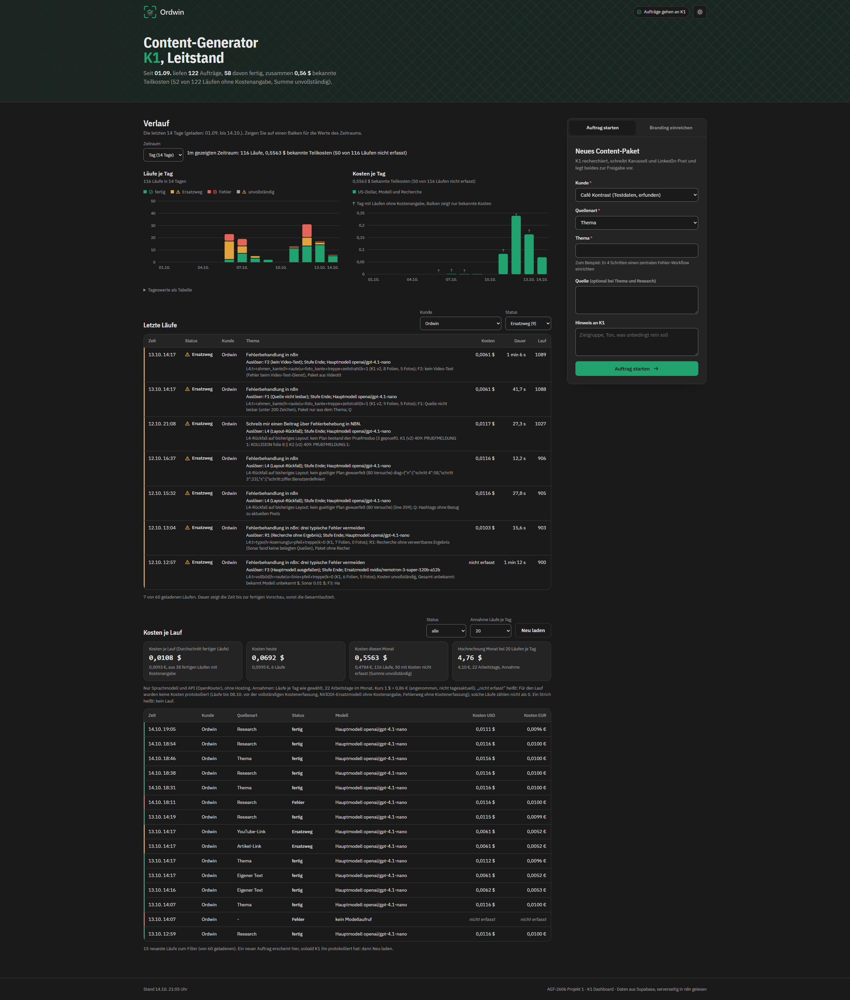

# Content-Maschine K1

Ein n8n-System, das aus einem Auftrag (Thema, Artikel-Link, YouTube-Link, eigener Text oder Recherche) ein fertiges Social-Media-Paket im Branding eines Kunden baut, es zur Freigabe in Telegram vorlegt und nach der Freigabe in Nextcloud ablegt. Gebaut als Projekt 1 im Kurs „KI-Automatisierung“ (AGT-2606), Oktober 2026.

## Was es tut

1. **Auftrag:** per Telegram (Text, Link, `/research`, Sprachnachricht), über das K1-Formular oder aus dem Leitstand.
2. **Quelle:** Artikel über Jina Reader, Video-Text über Supadata, sonst Thema oder eigener Text.
3. **Schreiben:** Perplexity Sonar recherchiert aktuelle Beiträge und belegte Aussagen, GPT-4.1 nano schreibt das Paket als JSON nach festem Schema; ist das Paket ungültig, schreibt das Ersatzmodell NVIDIA Nemotron.
4. **Gestalten:** Farben, Schrift und Layout aus dem Branding des Kunden, Foto von Pixabay oder Ersatzbild (FLUX), Gotenberg rendert die Bilder.
5. **Freigabe und Ablage:** Vorschau in Telegram, ein Mensch gibt frei oder lehnt mit Grund ab; nach der Freigabe legt der Sub-Workflow alles in Nextcloud ab und gibt einen Freigabelink zurück.

Ergebnis: Karussell, Einzelbild, Instagram-Text, LinkedIn-Post und ein Link zum Kundenordner.

## Musskriterien und wo man sie sieht

Belegt mit der Abgabe W05T03 vom 14.10.2026; seither kamen K1 v24 (Zeitgrenze des Schreibaufrufs, Einstellung „Estimated time saved“), Leitstand v17 (Lauf-Details, Modellpfad) und SUB Nextcloud-Ablage v04 (nur Layout der Notizen) dazu, die Zahlen der Tabelle gelten auch für diesen Stand. Jede Zeile verweist auf die Stelle, an der sie belegt ist.

| Kriterium | Woran man es sieht |
|---|---|
| Funktionalität: vollständiger Workflow, mindestens 2 APIs, Daten werden transformiert | 4 Workflows plus zentraler Error Workflow in [`workflows/`](workflows/); 11 Dienste in der [API-Übersicht](docs/api-uebersicht.md); Ablauf in der [Architektur](docs/architektur.md) |
| Fehlerbehandlung: mindestens 3 Fehlerszenarien, Try/Catch oder Fallback | Ersatzwege F1, F2, F3 und Fehlerweg für E5, F6, F3, F5, F8 in der [Architektur](docs/architektur.md); Retry an 17 Knoten; Alarm-Mail über den [Error Workflow](workflows/error-workflow.json); live belegt mit Lauf 1118 |
| Testing: mindestens 10 Testfälle mit Happy Path, Edge Cases, Fehlern | [Test-Tabelle](docs/test-tabelle.md) mit 22 Fällen (5 Happy Path, 11 Edge Case, 6 Fehler), je Fall Ergebnis und Lauf |
| Monitoring und Versionierung | Laufprotokoll in Supabase (Tabelle `k1_laufprotokoll`, Zeilen mit Status, Dauer, Tokens, Kosten je Lauf), [Leitstand](workflows/leitstand.json); jede Version ist ein Commit, siehe [versionen.md](versionen.md) und [CHANGELOG](CHANGELOG.md) |
| Dokumentation: Architektur, API-Übersicht, bekannte Einschränkungen | [Architektur](docs/architektur.md) mit [Diagramm](docs/architektur.png), [API-Übersicht](docs/api-uebersicht.md), [Bekannte Einschränkungen](docs/bekannte-einschraenkungen.md) |
| Bonus | Modularer Aufbau mit Sub-Workflow ([SUB Nextcloud-Ablage](workflows/sub-nextcloud-ablage.json)); Alerting per Mail ([Error Workflow](workflows/error-workflow.json)); [Kosten je Lauf](docs/kosten.md) (0,0116 USD im Mittel aus 9 Läufen); Prompt vorher und nachher gemessen ([Kosten](docs/kosten.md), [Lessons Learned](docs/lessons-learned.md)) |

## Architektur

Das Diagramm ist vereinfacht (Stand 14.10.2026); Laufprotokoll und Supabase-Objekte vollständig unter „Einrichtung“ und „Betrieb“.

| Datei | Workflow | Aufgabe |
|---|---|---|
| [`workflows/k1-content-generator.json`](workflows/k1-content-generator.json) | AGT-2606 P1 Content-Generator K1 | Hauptablauf in 5 Phasen mit Ersatzwegen und Fehlerweg |
| [`workflows/telegram-eingang.json`](workflows/telegram-eingang.json) | AGT-2606 P1 K1 Telegram-Eingang | nimmt Aufträge per Telegram an (Text, Link, Befehl, Sprache) und startet K1 |
| [`workflows/sub-nextcloud-ablage.json`](workflows/sub-nextcloud-ablage.json) | AGT-2606 P1 SUB Nextcloud-Ablage | legt Bilder und Texte nach der Freigabe in Nextcloud ab, gibt den Freigabelink zurück |
| [`workflows/leitstand.json`](workflows/leitstand.json) | AGT-2606 P1 K1 Dashboard | Webseite mit Basic Auth: Läufe, Kosten, Verlauf, Auftrag starten |
| [`workflows/error-workflow.json`](workflows/error-workflow.json) | AGT-2606 W03T04 Zentraler Error Workflow | Alarm-Mail, wenn ein automatisch gestarteter Lauf rot endet |

## Voraussetzungen

- n8n, selbst gehostet (gebaut und getestet auf einer eigenen Instanz; die Exporte enthalten nur Standard-Knoten, keine Community Nodes)
- Supabase (Tabellen und privater Bildspeicher), Nextcloud, Gotenberg (eigener Server)
- Zugänge für Telegram-Bot, OpenRouter, NVIDIA, Pixabay, Cloudflare Workers AI, Supadata; Jina Reader läuft ohne Schlüssel

## Einrichtung (zum Nachbauen und Prüfen)

1. Credentials in n8n anlegen. Die Exporte nennen nur den Namen des Credentials, die ID ist durch `CREDENTIAL_ID` ersetzt: Supabase API, Telegram API (2 Bots: Freigabe und Eingang), OpenRouter (Typ OpenAI), NVIDIA API, Header-Auth für Cloudflare Workers AI und Supadata, Query-Auth für Pixabay, Basic Auth für das K1-Formular und den Leitstand, Nextcloud, SMTP für die Alarm-Mail.
2. Platzhalter ersetzen: `https://SUPABASE_URL` (Supabase-Projektadresse), `https://NEXTCLOUD_URL`, `https://N8N_URL`, `TELEGRAM_USER_ID`, im Error Workflow Absender und Empfänger der Alarm-Mail (`<<REPLACE_WITH_YOUR_SENDER_EMAIL>>`, `<<REPLACE_WITH_YOUR_NOTIFICATION_EMAIL>>`).
3. Workflows in dieser Reihenfolge importieren: Error Workflow, SUB Nextcloud-Ablage, K1, Telegram-Eingang, Leitstand. Nach dem Import alle Credential-Felder neu zuweisen und die Workflow-IDs in den Aufrufknoten und Einstellungen (Error Workflow, erlaubte Aufrufer) auf die neuen IDs setzen.
4. In Supabase anlegen: die Tabellen `k1_kunden`, `k1_posts`, `k1_laufprotokoll`, `k1_einstellungen` und `k1_fehlermuster`, die Views `k1_dashboard_runs` und `k1_dashboard_daily`, die Funktionen `k1_dashboard_template` (liefert die HTML-Vorlage des Leitstands) und `k1_dashboard_save_branding` sowie einen privaten Storage-Bucket für die Bilder. Ein Schema-Skript dafür liegt noch nicht bei, siehe „Bekannte Lücken“; ohne diese Objekte laufen K1 und Leitstand nicht.
5. Erster Test über das K1-Formular mit einem Thema, danach die Fälle der [Test-Tabelle](docs/test-tabelle.md).

## Betrieb

- **Laufprotokoll:** ein Lauf schreibt in der Regel eine Zeile nach `k1_laufprotokoll` (Status, Dauer, Modell, Tokens, Kosten, Fehlertext); scheitert die Ablage nach der Freigabe, kommt eine zweite Zeile dazu. Scheitert ein Ladezugriff am Anfang oder die Fehlerzeile selbst, endet der Lauf rot in n8n ohne Protokollzeile (siehe [Architektur](docs/architektur.md)).
- **Alarm:** der zentrale Error Workflow schickt eine Mail, wenn ein automatisch gestarteter Lauf rot endet; manuell im Editor gestartete Läufe lösen ihn nicht aus.
- **Kosten:** rund 0,0116 USD je Themenlauf, fast nur Recherche, Details in [Kosten](docs/kosten.md).
- **Externer Wächter:** [`.github/workflows/waechter.yml`](.github/workflows/waechter.yml) prüft die Instanz von außen. Der Zeitplan ist noch abgeschaltet, weil die zugehörigen n8n-Workflows (Lebenszeichen, Probe) noch nicht in Betrieb sind; bis dahin nur Handstart.

## Versionen

Jede Workflow-Version ist ein Commit mit Datum und Uhrzeit der Version; jede Abgabe ist ein Tag (`abgabe-JJJJ-MM-TT-wNNtNN`). Übersicht mit Links auf Commit und Unterschied: [versionen.md](versionen.md). Änderungen mit Begründung: [CHANGELOG.md](CHANGELOG.md). Die Abgabe W04T04 lief auf einer Kopie von K1 und liegt auf dem Zweig `w04t04-token-logging`.

## Bekannte Einschränkungen

Siehe [Bekannte Einschränkungen](docs/bekannte-einschraenkungen.md) (5 gemessene Grenzen).

**Bekannte Lücken dieses Repositorys:** kein Schema-Skript für die Supabase-Objekte aus Schritt 4 der Einrichtung, insbesondere fehlt die HTML-Vorlage des Leitstands (`k1_dashboard_template`); die Konfigurationswerte stehen nur in den Workflows bzw. in `k1_einstellungen`.

## Abgaben

Übersicht aller Abgaben je Kurstag mit Tag und Datum: [`abgaben/`](abgaben/README.md). Im Repository liegen die Planung (W04T01) und die Folien der Abschlusspräsentation (W05T03); die übrigen PDFs sind in Moodle abgegeben.

## Lizenz

Alle Rechte vorbehalten, siehe [LICENSE](LICENSE). Einsicht zur Bewertung und zum Lernen ist erlaubt; Nutzung, Weitergabe und Verkauf nur nach Absprache.
