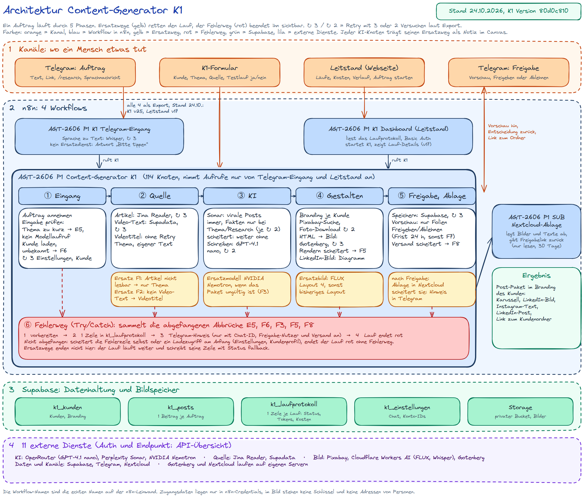

# Architektur: 5 Phasen, ein Fehlerweg, 4 Workflows

_Endstand vom 24.10.2026 (K1 v25 `4a2e6a4d` plus Notizen, aktive Version `80d0c810`; Telegram-Eingang v08, SUB Nextcloud-Ablage v04, Leitstand v17). Der Stand der Abgabe W05T03 vom 14.10.2026 (K1 v23 `99e45166`) ist mit dem Tag `abgabe-2026-10-14-w05t03` abrufbar. Änderungen dazwischen stehen im [CHANGELOG](../CHANGELOG.md)._

Das Diagramm ist am 24.10.2026 gegen den Export K1 v25 abgeglichen, dazu die Notizen vom 24.10.: Knoten, Verbindungen, Retry-Einstellungen und Fehlerausgänge wurden aus der JSON gelesen, nicht aus dem Gedächtnis gezeichnet. Das Diagramm ist unten eingebunden. Es ist vereinfacht: Ein Lauf schreibt in der Regel 1 Zeile ins Laufprotokoll, bei einem Ablagefehler nach der Freigabe eine zweite, bei einem Ladefehler am Anfang keine; der Leitstand braucht in Supabase zusätzlich `k1_fehlermuster`, die Views `k1_dashboard_runs` und `k1_dashboard_daily` und die Funktionen `k1_dashboard_template` und `k1_dashboard_save_branding`. Gelb sind Ersatzwege, die den Lauf retten, rot ist der Fehlerweg, der ihn sichtbar beendet. Das Zeichen ↻ mit Zahl steht für Retry mit dieser Zahl an Versuchen laut Export.

## Die Phasen in Sätzen

- **Eingang:** Ein Auftrag kommt über das Formular oder über den Telegram-Eingang, der Text, Links und Sprachnachrichten annimmt. K1 prüft zuerst die Eingabe: Ein leeres Thema oder eines unter 3 Zeichen stoppt ohne Modellaufruf (E5, Lauf 1084 nach 0,8 s), ein unbekannter Kunde ebenso (F6).

- **Quelle:** Ein Artikel wird über Jina Reader, ein Video über Supadata zu reinem Text. Ist der Artikel nicht lesbar, entsteht das Paket nur aus dem Thema (F1); fehlt der Video-Text, aus Videotitel und Thema (F2).

- **KI:** Perplexity Sonar sucht bei jedem gültigen Auftrag aktuelle Beiträge als Vorlage; nur bei Thema und Research recherchiert es zusätzlich belegte Aussagen und meldet Teilaspekte ohne Beleg als Lücke. Danach schreibt GPT-4.1 nano das Paket als JSON nach festem Schema (Prompt-Version `k1-p5`), mit eigener Einleitung für Folie 2, einem Aufhänger für Folie 1 und einer Erklärung je Ablaufschritt. Ist das Paket ungültig, schreibt es das Ersatzmodell NVIDIA Nemotron (F3).

- **Gestalten:** Das Branding des Kunden bestimmt Farben, Schrift und Layout. Ein Foto kommt von Pixabay, wenn mindestens 2 Suchwörter einer fotografierbaren Szene passen, sonst malt FLUX das Bild für Folie 1. Das LinkedIn-Bild ist eine eigene Grafik, bei einem Ablauf ein Diagramm mit einer Station je Schritt. Gotenberg macht aus dem HTML die Bilder; scheitert Layout 4, greift das bisherige Layout, scheitert das Rendern ganz, bricht der Lauf ab (F5).

- **Freigabe und Ablage:** K1 speichert den Beitrag in Supabase und schickt die Vorschau nach Telegram, nur mit den Folien; das LinkedIn-Bild kommt einmal mit dem LinkedIn-Text, die Freigabe nennt die Domains der Recherche-Quellen. Ein Mensch gibt frei oder lehnt mit Grund ab (Frist 24 Stunden). Erst nach der Freigabe legt der Sub-Workflow Nextcloud-Ablage alles beim Kunden ab und gibt den Freigabelink zurück.

**Fehlerbehandlung:** 17 Knoten haben Retry: 12 mit 3 Versuchen, 4 mit 2 Versuchen, 1 Knoten (`Status setzen`) ohne eigenen Wert, dort gilt die Voreinstellung von n8n. Die abgefangenen Abbrüche E5, F6, F3, F5 und F8 laufen in den Fehlerweg: 1 Zeile ins Laufprotokoll, ein Hinweis in Telegram, sofern Chat-ID, Freigabe-Nutzer und Telegram-Versand gesetzt sind, dann endet der Lauf rot. Live belegt am 14.10. mit Lauf 1118 (F8, Telegram meldete „Gateway Timeout“): Protokollzeile, Telegram-Hinweis und rotes Ende um 18:11:53. Zusätzlich ist in den Einstellungen von K1 ein zentraler Error Workflow eingetragen, der bei einem rot endenden Lauf eine Alarm-Mail mit Lauf, Knoten und Fehler schickt; bei Lauf 1118 kam sie um 18:11:55. Manuell im Editor gestartete Läufe lösen ihn nicht aus. Nicht abgefangen sind ein Ausfall der Fehlerzeile selbst und der Ladezugriffe am Anfang (Einstellungen, Kundenprofil, je 3 Versuche): dann endet der Lauf rot in n8n, ohne Fehlerweg. Ersatzwege schreiben ihre Zeile mit Status `fallback` und laufen weiter. Seit dem 24.10. trägt jeder der 5 KI-Knoten seinen Ersatzweg als Notiz im Canvas: `Virale Posts Sonar` R2, `Recherche Sonar` R1, `Content-Paket schreiben` F3, `Ersatzpaket schreiben` keiner, `Einzelbild erzeugen` F4. Diese Notizen und die berichtigte Karte ④ sind im Export v25 noch nicht enthalten.

**4 Workflows, alle 4 als Export:** Telegram-Eingang (40 Knoten) und Leitstand (56 Knoten) rufen K1 auf, K1 (114 Knoten) ruft die Nextcloud-Ablage (40 Knoten). Alle 4 liegen als Export in `workflows/`, der Leitstand als `workflows/leitstand.json` (v17, aktive Version `98c3c22a`). K1 nimmt Aufrufe nur von diesen beiden Workflows an. Der Leitstand ist eine Webseite mit Basic Auth, die Läufe, Kosten und Verlauf aus dem Laufprotokoll zeigt; seit der Veröffentlichung am 14.10. startet er K1 direkt, belegt mit den Probeläufen 1118 und 1128, seit v17 zeigt er je Lauf Details.

_Architektur-Diagramm Content-Generator K1, Stand 24.10.2026._
